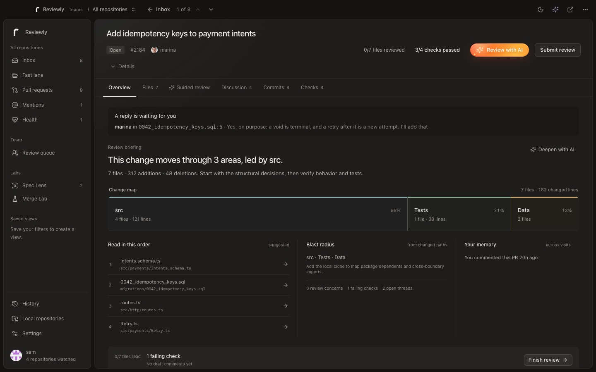
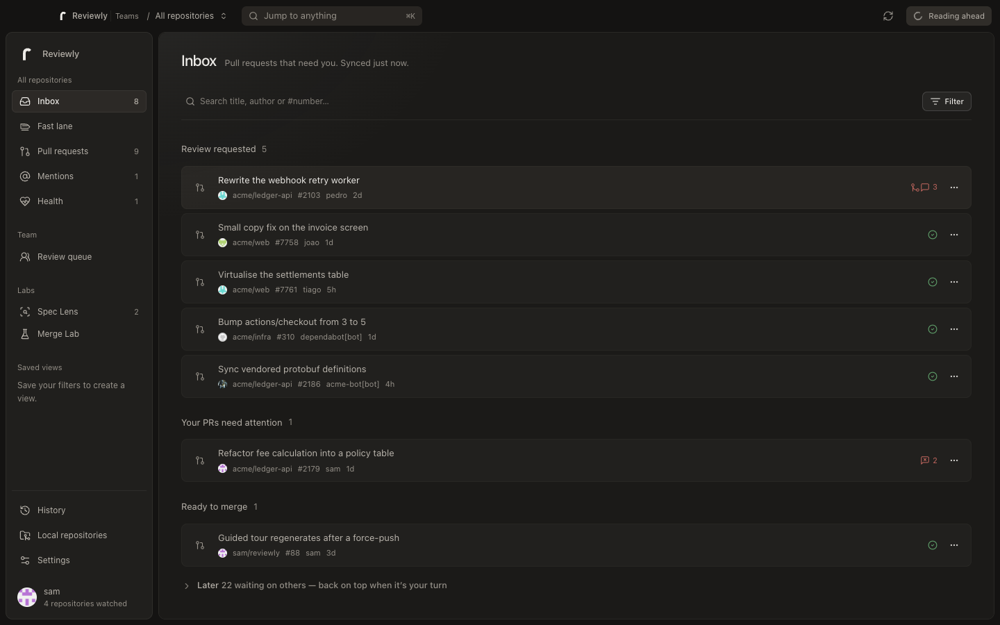
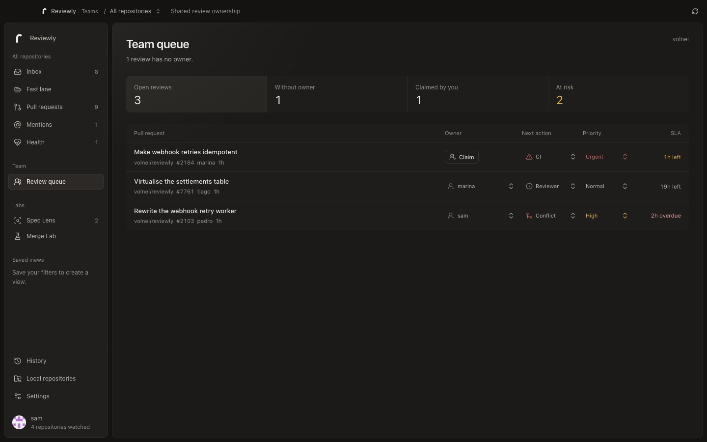

<p align="center">
  <a href="https://getreviewly.dev/">
    
  </a>
</p>

<h1 align="center">Reviewly</h1>

<p align="center">
  <strong>Pull requests. Focused.</strong><br />
  A fast, local-first desktop workspace for reviewing GitHub pull requests with private AI and optional team coordination.
</p>

<p align="center">
  <a href="https://github.com/volnei/reviewly/releases"></a>
  <a href="https://github.com/volnei/reviewly/actions/workflows/ci.yml"></a>
  <a href="LICENSE"></a>
  <a href="https://github.com/volnei/reviewly/stargazers"></a>
  <a href="https://github.com/volnei/reviewly/releases"></a>
</p>

<p align="center">
  <a href="https://getreviewly.dev/"><strong>Website</strong></a>
  ·
  <a href="https://github.com/volnei/reviewly/releases"><strong>Download</strong></a>
  ·
  <a href="https://github.com/volnei/reviewly/issues"><strong>Issues</strong></a>
</p>



Reviewly turns the work of reviewing a pull request into one coherent desktop flow. It finds what needs you, explains the shape of the change, keeps the diff and its discussion together, and sends the final review back to GitHub.

- **One ordered inbox.** Review requests, your blocked PRs, merge-ready work and open threads are already separated.
- **A reviewer-first PR view.** Start with the change map, checks and unresolved context, then move through files in a deliberate order.
- **Private AI.** Use Claude, Codex, Antigravity, Gemini or an OpenAI-compatible endpoint you control. Reviewly does not operate a hosted AI service.
- **Native and local-first.** PR data and drafts are cached in SQLite. Credentials live in the operating system keychain.
- **Optional Teams coordination.** Shared ownership, priority, SLA and one queue across a GitHub organization.

Built with **Tauri 2, Rust, React and TypeScript**. Hobby mode is free and open source under the [GPL-3.0](LICENSE).

## Install

### Homebrew

```sh
brew install --cask volnei/tap/reviewly
```

### Direct download

Download the latest installer from [GitHub Releases](https://github.com/volnei/reviewly/releases):

| Platform | Packages |
| --- | --- |
| macOS | Universal DMG, signed and notarized |
| Windows | NSIS installer and MSI |
| Linux | AppImage, DEB and RPM |

Reviewly walks through GitHub sign-in and repository selection on first launch. Updates are delivered from signed GitHub releases inside the app.

## The review workspace

### Know what needs you



The inbox is built around attention, not chronology. It separates requested reviews, your PRs that need action, work ready to merge and items waiting on someone else. Search and filters operate on the local SQLite mirror, so large accounts remain fast.

### Understand before reading every line

The PR overview puts the evidence first:

- a map of the areas changed and their relative size;
- the suggested reading order;
- required checks and unresolved review threads;
- previous activity and saved review context;
- a path into the complete diff, conversation, commits and checks.

Inside the diff you can switch between unified and split layouts, expand context, hide whitespace-only changes, wrap long lines and track viewed files against the current head commit.

### Review without losing your place

Reviewly keeps inline comments in a per-PR draft that survives navigation and restarts. Read and reply to threads, resolve conversations, add reactions, edit labels and submit one GitHub review as **Comment**, **Approve** or **Request changes**.

Keyboard navigation is available across lists and the review workspace. Press `?` in the app for the complete shortcut sheet.

### Let AI help without choosing your AI for you

Reviewly supports three complementary workflows:

- **Change briefing** maps the PR into coherent areas and highlights what deserves attention.
- **Guided review** walks through the change in a sensible order, with direct jumps to relevant files and lines.
- **Ask AI** keeps a per-PR conversation and can work inside a local clone when one is connected.

| Provider | Execution model |
| --- | --- |
| Claude | Local `claude` CLI |
| Codex | Local `codex` CLI |
| Antigravity | Local `agy` CLI |
| Gemini | Local `gemini` CLI |
| OpenAI-compatible | Your chosen HTTP endpoint and model |

Custom review instructions can encode project conventions once and apply them to every briefing and conversation.

## Hobby and Teams



| | Hobby | Teams |
| --- | --- | --- |
| Price | Free | **US$8 per user / month** |
| Native review workspace | Included | Included |
| Local PR cache and drafts | Included | Included |
| Private AI providers | Included | Included |
| GitHub Enterprise Server | Included | Included |
| Shared review ownership | — | Included |
| Team priority and SLA | — | Included |
| Organization review queue | — | Included |

Hobby works without a Reviewly account. Teams signs in separately and uses the Reviewly Teams service only for organization membership, billing and review-coordination metadata. Source code and diffs remain between the desktop app, GitHub and the AI provider you choose.

## GitHub Enterprise Server

Choose **Enterprise Server** during connection and enter the company hostname, such as `github.company.com`. Reviewly derives the REST and GraphQL endpoints automatically.

Authenticate with either:

- an existing GitHub CLI session created with `gh auth login --hostname github.company.com`; or
- a personal access token with the repository, user, notification and workflow access needed by the features you use.

The hostname and credential are stored together in the OS keychain. Switching hosts clears the previous server's local PR mirror so data from separate installations is never mixed.

## Privacy and security

- **Credentials stay in the OS keychain.** GitHub, Teams and optional AI credentials are not written to plaintext configuration files.
- **No Reviewly telemetry.** The desktop app does not collect product analytics or behavioral events.
- **No hosted Reviewly AI.** AI requests go only to the CLI or endpoint selected in Settings.
- **Local work stays local.** A local CLI can read the connected clone; Reviewly does not upload that clone to its own service.
- **Teams is metadata-only.** The optional Teams backend stores coordination and billing data, not repository source or diffs.

## How it works

```text
┌──────────────────────────── Reviewly desktop ────────────────────────────┐
│ React · TanStack Router/Query · local SQLite views · review workspace   │
└───────────────────┬───────────────────────────────┬──────────────────────┘
                    │ typed Tauri commands           │ optional Teams session
┌───────────────────▼───────────────────┐   ┌────────▼─────────────────────┐
│ Rust core                             │   │ Reviewly Teams API           │
│ GitHub REST + GraphQL · keychain      │   │ ownership · priority · SLA   │
│ git · local AI CLIs · updater         │   │ billing · organization sync  │
└───────────────┬───────────────────────┘   └────────┬─────────────────────┘
                │                                     │
        ┌───────▼────────┐                    ┌────────▼────────┐
        │ GitHub / GHES  │                    │ GitHub App      │
        └────────────────┘                    └─────────────────┘
```

The Rust core is the only layer that talks to GitHub and the operating system. The React interface calls typed commands and renders local state. A background worker reconciles selected repositories, updates the dock and tray count, and sends native notifications for new review requests.

## Build from source

### Requirements

1. [Bun](https://bun.sh) 1.3 or newer
2. Rust stable
3. The [Tauri platform prerequisites](https://tauri.app/start/prerequisites/) for your operating system

```sh
git clone https://github.com/volnei/reviewly.git
cd reviewly
bun install
bun run tauri dev
```

Useful commands:

```sh
bun run typecheck       # TypeScript
bun lint                # Bun's official linter
bun fmt                 # Bun's formatter
bun run build           # desktop webview bundle
cargo check --manifest-path src-tauri/Cargo.toml
```

The public GitHub OAuth client ID is configured in [`src-tauri/.cargo/config.toml`](src-tauri/.cargo/config.toml). Forks can replace it with their own OAuth app with Device Flow enabled.

## Product site

The product site and Reviewly Teams service deploy together on Vercel at [getreviewly.dev](https://getreviewly.dev/). Its source lives in the separate [`volnei/reviewly-teams`](https://github.com/volnei/reviewly-teams) repository.

## Contributing

Issues and pull requests are welcome. Before opening a PR, run the relevant checks from the commands above. Changes to Rust should include `cargo check`; changes to the app should include typechecking and linting.

## License

Reviewly Hobby is licensed under the [GNU General Public License v3.0 or later](LICENSE). You may use, study, share and modify it; derivative works must remain under the GPL.
